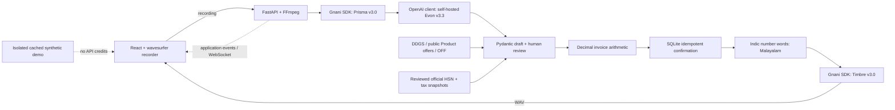

# VyaparSetu · വ്യാപാരസേതു

Malayalam-first voice billing for a hands-busy kirana shop. Speak a mixed Malayalam/English bill, review corrections and price/tax evidence, save a synthetic credit entry, and hear the confirmation in Malayalam.

**Demo customers and transactions are synthetic. Product information can come from public sources. This is a demonstration ledger, not tax-filing software.**

## Run locally

Prerequisites: Python 3.12, uv, Node 22.12+ and npm. FFmpeg is used for microphone recordings; `imageio-ffmpeg` provides a bundled executable when a system binary is unavailable. eSpeak NG with `ml` voice generates the deliberately labeled offline mock audio.

```sh
cp .env.example .env
cd backend
uv sync --extra dev --python 3.12
uv run uvicorn app.main:app --host 127.0.0.1 --port 8000
```

In another terminal:

```sh
cd frontend
npm ci
npm run dev -- --host 127.0.0.1 --port 5173
```

Open <http://127.0.0.1:5173>. Leave `USE_MOCKS=true` to exercise the demo without provider requests or API credits. Browser microphone access requires localhost or HTTPS; an unsecured LAN IP on a phone will not work. Manual drafts, lookup review, ledger and PDF do not require voice credentials. Demo replay works even when the backend is unavailable and is always labeled cached/mock, not live inference.

To regenerate bundled synthetic backend audio: `cd backend && uv run python scripts/generate_mock_audio.py`. These files use eSpeak NG, not Timbre; frontend cached input/reply assets are labeled the same way.

PDF export uses **jsPDF 4.2.1 + html2canvas 1.4.1** on demand. The initial react-pdf route stalled browser interaction during export; the shipped fallback lets Chromium shape Malayalam with bundled static Noto and embeds page images. An exported receipt was downloaded, opened and visually inspected. Ten invoice rows per page avoid splitting a row; source references and manual overrides are retained. Raster text is not searchable. The eager renderer was removed, not left as a second PDF path.

Browser verification uses Playwright 1.64.1 against Chromium. The registry advertised Playwright 1.65.0 but its matching playwright-core package was unavailable; the compatible published pair is pinned in the lockfile.


## Architecture



The WebSocket carries application stages, **not** custom Gnani audio frames. Push-to-talk transcription arrives after release. No Agent Builder, raw provider WebSocket framing, custom waveform or LLM arithmetic is used.

## Configuration

Copy the root `.env.example`; never commit `.env`. All credentials stay on the backend.

| Variable | Use |
|---|---|
| `USE_MOCKS` | Single global mock/live switch; default `true` |
| `GNANI_API_KEY` | One Gnani key with STT/TTS scopes and sufficient programme credits |
| `GNANI_BASE_URL` | `https://api.vachana.ai` |
| `STT_MODEL` | Explicit `prisma-v3.0`; omission selects an older default |
| `STT_LANGUAGES` | `ml-IN,en-IN`, candidate hints rather than unrestricted detection |
| `STT_FORMAT` | `transcribe`; compare against `codemix` before changing |
| `TTS_MODEL` | Explicit `timbre-v3.0` |
| `TTS_VOICE` | `Shivani`, a v3 polyglot voice |
| `TTS_LANGUAGE` | SDK-supported `ml-IN` |
| `TTS_SPEED` | `0.90`, slower for clear confirmations |
| `EVON_BASE_URL` | Your secured OpenAI-compatible URL **including `/v1`** |
| `EVON_API_KEY` | Your endpoint's API token; never a paid hosted OpenAI model key |
| `EVON_MODEL` | Actual served model ID; deployment kit uses `vyaparsetu-evon` |
| `DATABASE_PATH` | Local persistent ledger file; never public GitHub data |

### Exact model use and design choices

**Prisma v3.0.** REST uses the official `gnani-vachana` client against `POST /stt/v3`, explicit `model="prisma-v3.0"`, comma-separated `language_code="ml-IN,en-IN"`, `format="transcribe"`, SDK `keywords` (REST `keyterms`) and a kirana-billing topic. The fifty synthetic catalog products seed the Malayalam/Manglish hints, not an allowlist of supported items. Browser WebM is decoded by FFmpeg into WAV, never renamed. Recordings stop at 25 seconds before the provider's 30-second maximum.

**Language candidates.** Known Malayalam/English hints are more appropriate than bare `indic-auto` for short code-mixed billing. They are hints, not a language lock. Returned `detected_language_code` comes from transcript script, not independent acoustic confidence, and can be absent on empty/numeric output. `transcribe` requests conventional numbers; `codemix` often retains spoken number words. No comparison quality claims are made until actual recorded responses are inspected.

**Evon v3.3.** The weights are `gnani/gnani-evon-v3.3-30B-A3B`. `AsyncOpenAI` points to the self-hosted endpoint and uses a named `extract_invoice` function call with Pydantic validation. `extra_body={"chat_template_kwargs":{"enable_thinking":False}}` avoids unnecessary reasoning output for short extraction; `max_retries=0` avoids hidden repeated calls. Missing price, quantity ambiguity or tax classification enters review; the model never chooses authoritative tax rates or computes money.

**Number normalization.** `indic-numtowords` supports Malayalam (`lang="ml"`); ordinary `num2words` does not. Authoritative integer paise are split into rupees/paise and converted with the library before entering a short Malayalam template. A final Unicode-digit check prevents sending raw digits to Timbre. New Gnani normalization documentation says automatic number handling exists, contradicting older warnings; this app deliberately follows the stricter pre-normalization requirement.

**Timbre v3.0.** Official SDK synthesis uses `model="timbre-v3.0"`, `voice="Shivani"`, `language="ml-IN"`, `speed=0.90`, 48kHz mono 16-bit WAV. v2.5 voices are not interchangeable with v3. A shared account speech lock serializes STT/TTS calls; playback or synthesis failure never reposts an invoice. The player reports actual `playing` state and offers a play button when browser autoplay is blocked.

**Deterministic money and persistence.** Decimal/ROUND_HALF_UP computes rounded line amounts and taxes. Retail **inclusive** prices are split into net/tax rather than taxed twice; unknown price basis requires review. SQLite confirmation is transactional and idempotent by run ID. Synthetic fixture bill: rice 3×40 at illustrative 5%, soap 1×20 at illustrative 18% = subtotal ₹140, GST ₹9.60, total ₹149.60; synthetic opening credit ₹100 becomes ₹249.60 once. Those slabs are test data, not claims about current real rice/soap classifications.

## Product prices and GST evidence

Search accepts arbitrary products, including items outside the synthetic catalog. Identity, seller/observed price and GST classification are separate records. Public search is discovery, not a guarantee that a result is available or priced for your locality. Brand, pack, currency, price type, date and source stay visible. MRP is not silently substituted for selling price. A 500g pack is not a per-kilo price without explicit conversion review.

DDGS is a maintained free metasearch library, not a guaranteed official search API. Upstreams can throttle or present challenges; the app does not bypass CAPTCHA or add paid search services. `extruct` reads publisher Product/Offer metadata, not arbitrary price-looking snippet numbers. `safehttpx` protects public-page fetches against private-network/DNS-rebinding targets; publisher robots restrictions are respected. No receipt images or contributor/customer identities are imported.

Known barcodes can enrich food identity through [Open Food Facts](https://world.openfoodfacts.org/) and INR price observations through [Open Prices](https://prices.openfoodfacts.org/). Coverage is crowdsourced and incomplete. Open Food Facts/Open Prices data is attributed under their ODbL/content terms and cached separately from shop selections and ledger records. No customer transaction is submitted back to those services.

### Official GST imports

No official tax dataset is bundled as if complete/current. `backend/data/gst/source_manifest.json` records the initial not-imported state. Unknown GST is **not zero**. A user-entered override stays labeled user-provided; selecting source-backed evidence freezes it into the saved invoice so future refreshes cannot change an old bill.

[GSTN's official instructions](https://tutorial.gst.gov.in/userguide/taxpayersdashboard/Search_HSN_SAC_Tax_Rates.htm) describe **Services → User Services → Search HSN Code → Download HSN Directory in Excel Format**. No documented permanent XLSX URL/public arbitrary-product rate API was established. Download the official workbook, inspect its headers, then import with explicit mapping:

```sh
cd backend
uv run python scripts/import_gst.py hsn --input /path/official.xlsx
uv run python scripts/import_gst.py hsn --input /path/official.xlsx \
  --code-column 'EXACT CODE HEADER' --description-column 'EXACT DESCRIPTION HEADER' \
  --source-url https://services.gst.gov.in/services/searchhsnsac --retrieved-at YYYY-MM-DD
uv run python scripts/import_gst.py rates --rules /path/reviewed-rules.json --manifest /path/source_manifest.json
```

Rates must include HSN/legal description, CGST/SGST/IGST/cess, conditions, valuation, effective dates, notification, official URL, local PDF checksum, one-based page and source excerpt. The importer validates all records against supplied source PDFs before atomic activation; it does not let an LLM guess a trusted schedule. Packaging, composition and supply date can affect classification; overlapping applicable rules require review. Cess/specific valuation or interstate requirements are not silently treated as ordinary intra-state grocery tax.

Primary official references: [CBIC Tax Information](https://taxinformation.cbic.gov.in/), [GSTN HSN search](https://services.gst.gov.in/services/searchhsnsac), [09/2025 CT(Rate) reference](https://taxinformation.cbic.gov.in/view-pdf/1010436/ENG/Notifications). Later amendments must be checked. Council recommendations alone are not operative law. Certificate/access failures during planning were not bypassed; missing snapshots remain visible as unavailable rather than invented rates.

## Verification and live-model handoff

```sh
cd backend
uv run pytest
cd ../frontend
npm run build
```

Tests supplement the actual browser walkthrough: demo/correction, review, confirm, persisted balance, duplicate-confirm, audio, responsive English/Malayalam themes, offline replay and opened PDF. Module-level evidence and exact commit IDs are reported after each verified push. Mock/local-contract tests are **not** real-model proof.

Runpod is unfunded. **Do not launch GPU resources now.** `deploy/evon/compose.yaml` is a deployment kit, not a running endpoint. Later provide a funded secured `/v1` URL, served model ID/token, and a GPU runtime. The model has ~63.5GB BF16 weights before runtime/cache; an 80GB GPU with short context is only a sizing estimate, not a proven fit. Recheck live price/stock and spending approval before any rental. No persistent paid resource is needed while developing the UI.

Live speech certification remains Prisma → Evon → Timbre. Provide `GNANI_API_KEY` locally for Gnani tests and a funded endpoint for Evon. Use the explicit smoke scripts rather than triggering API requests on startup/build. Cache only actual successful outputs with their source metadata. A cached replay is visibly labeled and never silently replaces an arbitrary live recording.

## Public demo / challenge

Use synthetic customers/transactions only; do not show real phone numbers, Aadhaar/PAN, customer calls or credentials. Tell the sixty-second story through correction → evidence/review → saved credit → Malayalam reply → PDF. Do not claim noisy microphone input proves telephony robustness, or show cached latency as a live measurement.

[Official challenge](https://www.gnani.ai/internship): publish a working video on LinkedIn/X, tag Gnani AI and add `#GnaniAI` and `#GreatIndianAIInternshipChallenge`, then nominate the live post link with the project explanation/models before the stated deadline. No bought engagement or misleading demos. User handles eligibility, registration and final publication.
